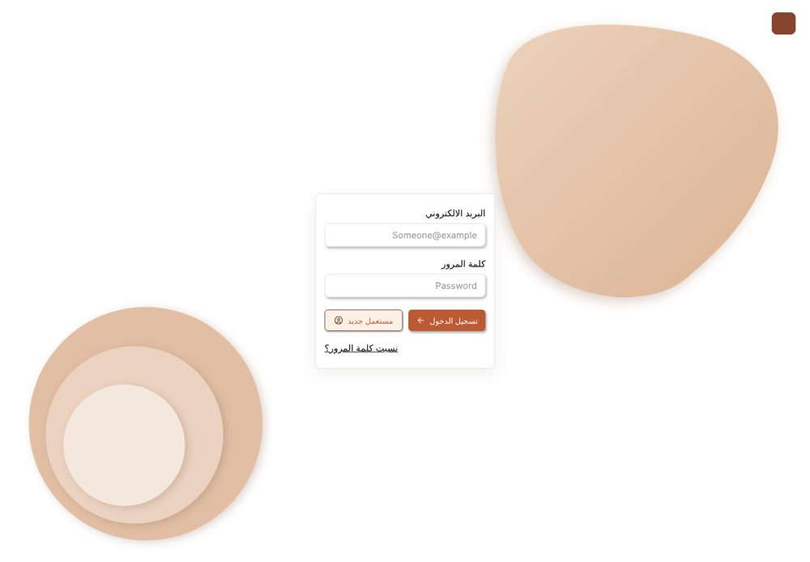
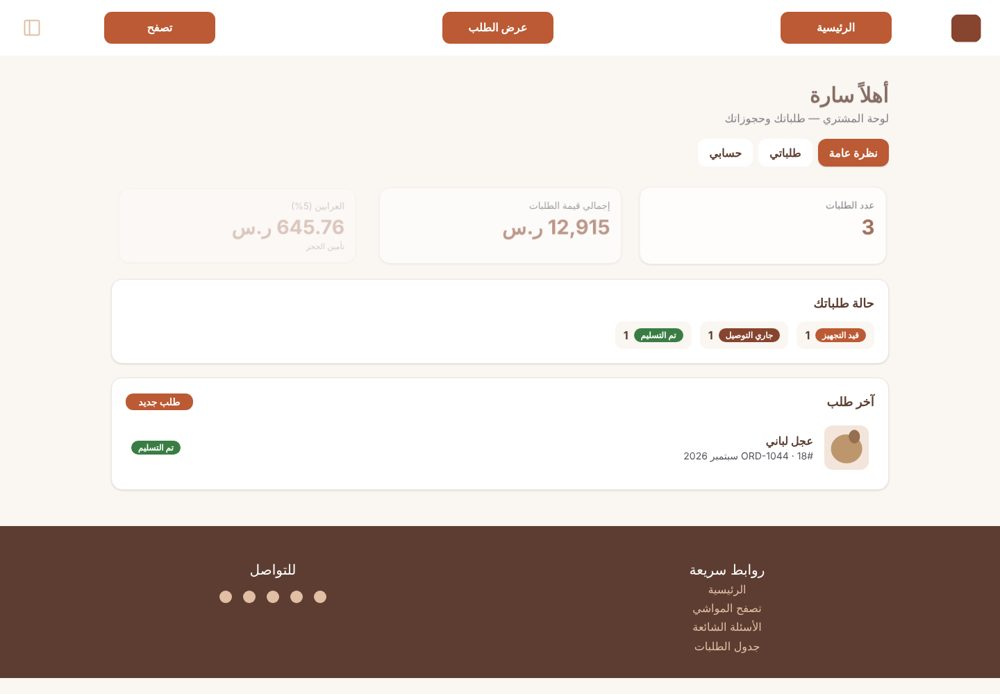
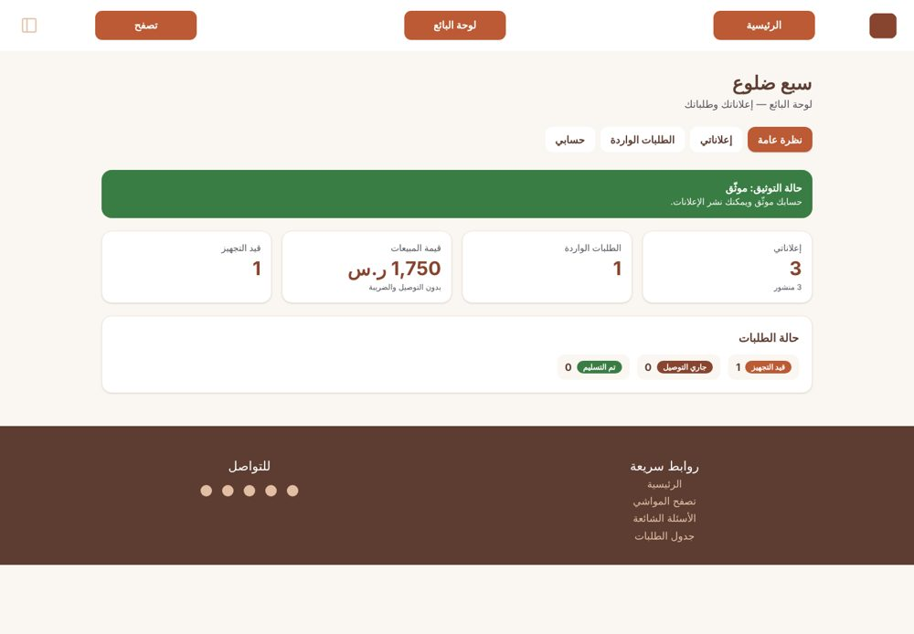
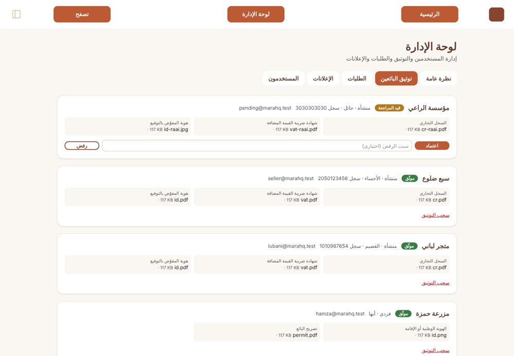

# مراح كيو (Marahq Q)

A livestock and sacrifice (أضاحي) marketplace for Saudi Arabia. Buyers browse verified sellers and reserve an animal with a 5% deposit; sellers publish listings after admin verification; admins manage everything.

Built from a Figma design (Arabic, RTL) as a course project.

**Stack:** React 18 + Tailwind CSS (front end), Node.js + Express (custom REST API), Firebase Authentication + Cloud Firestore (optional, falls back to a local JSON file).

| Login | Buyer dashboard |
| --- | --- |
|  |  |
| **Seller dashboard** | **Admin, seller verification** |
|  |  |

> The screenshots use grey placeholder pictures. Run `npm run images` to download the real Figma images (see below).

## Features

- **Landing page** from the Figma design: hero, how it works, categories, latest listings, stats, call to action. All text and listings come from the API.
- **Sign up / log in** with password rules, then **onboarding**: name and info, buyer or seller, (seller) solo or business, demo document upload (only the file name and size are kept), review, animated success.
- **Order flow:** order form (delivery or pickup), orders table, order details. The server calculates prices: price + delivery (50 SAR, free for pickup) + 15% VAT; deposit is 5%.
- **Three roles, three dashboards** (every tab is its own API call):
  - **Buyer** `#/buyer`, overview, orders, account.
  - **Seller** `#/seller`, overview, my listings (publish / edit price / hide), incoming orders, account. Publishing needs admin approval.
  - **Admin** `#/admin`, overview, seller verification, all orders (change status), listings (hide / block), users.
- **Animations:** hero rise-in, scroll reveal, count-up numbers, hover lifts, step transitions, fake upload progress, drawing checkmark, error shake, floating background shapes (all switch off for "reduce motion").
- RTL Arabic, responsive (the order screens are drawn at 1440 px and scale down).

## Project structure

```
server.js              the whole API (data, login, roles, orders, dashboards) in one file
public/
  index.html           page shell: loads Tailwind + React
  app.jsx              the front end: every screen and dashboard tab is a React component
  design.css           landing-page CSS from Figma + animations + login page styles
  assets/              images (placeholders until you run `npm run images`)
  vendor/              React, ReactDOM, Babel and Tailwind, saved locally (no build step)
get-images.js          downloads the real Figma images into public/assets
assets-manifest.json   list of images for get-images.js
firebase.config.json   put your Firebase Web API key here (optional)
```

There is no build step: React and Tailwind run in the browser, which keeps the project small. A production site would pre-build them (for example with Vite).

## Run it

Requires **Node.js 18+**.

```bash
npm install
npm run images     # optional: download the real Figma images (links expire after ~7 days)
npm start
```

Open **http://localhost:3000**. Without Firebase, data is stored in a local `db.json` (delete it to reset).

### Demo accounts

| Role | Email | Password |
| --- | --- | --- |
| Buyer | `demo@marahq.test` | `Demo@12345` |
| Seller (verified) | `seller@marahq.test` | `Seller@12345` |
| Seller (waiting for approval) | `pending@marahq.test` | `Seller@12345` |
| Admin | `admin@marahq.test` | `Admin@12345` |

Try: log in as the pending seller (cannot publish), then log in as admin, open *توثيق البائعين*, press *اعتماد*, and the seller can now publish.

## Firebase

Firebase is optional. Setup steps are in [docs/FIREBASE.md](docs/FIREBASE.md).

## API

| Request | Who | Returns |
| --- | --- | --- |
| `GET /api/site` | anyone | menu, footer, FAQ |
| `GET /api/content`, `/api/listings`, `/api/pricing`, `/api/seller-documents` | anyone | landing data, listings, fees, required documents |
| `POST /api/auth/register`, `/login`, `/refresh`, `GET /api/auth/me` | anyone / logged in | token and user |
| `PUT /api/profile` | logged in | saves onboarding |
| `GET /api/orders`, `/api/orders/:id`, `POST /api/orders` | buyer | your orders; create an order |
| `GET /api/buyer/stats` | buyer | dashboard numbers |
| `GET /api/seller/stats`, `/listings`, `/orders`, `POST`/`PATCH /api/seller/listings` | seller | dashboard tabs; publish and edit listings |
| `GET /api/admin/stats`, `/users`, `/verifications`, `/orders`, `/listings` | admin | dashboard tabs |
| `POST /api/admin/verifications/:id`, `PATCH /api/admin/orders/:id`, `/listings/:id` | admin | approve or reject sellers; change order status; hide or block listings |

The server checks login and role on every request, and calculates all prices itself.

## Notes

- Seller documents are **demo only**: only the file name and size are stored; never upload real IDs.
- Google sign-in and password reset are not enabled.
- Figma image links in `assets-manifest.json` are temporary; if `npm run images` returns 403, the links have expired.

---

## بالعربي (ملخّص)

**مراح كيو** منصة لبيع وشراء المواشي والأضاحي. الواجهة React + Tailwind، والـ API مكتوب بـ Node/Express، والتسجيل وقاعدة البيانات عبر Firebase (اختياري؛ بدونه تُحفظ البيانات في ملف محلي).

- التشغيل: `npm install` ثم `npm start` ثم افتح `http://localhost:3000`.
- الصور الأصلية من Figma: `npm run images`.
- ثلاثة أنواع حسابات: مشتري / بائع / مدير، ولكل منها لوحة تحكم، وكل تبويب يجلب بياناته من الـ API.
- الحسابات التجريبية في الجدول أعلاه.
